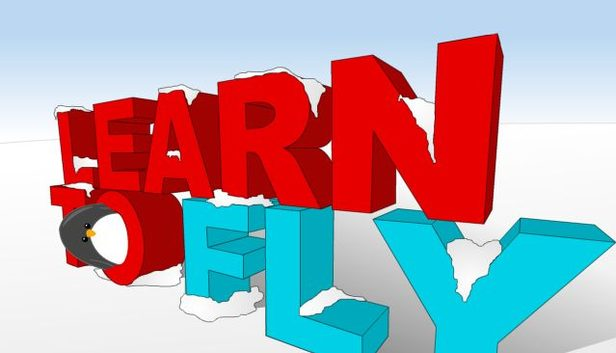

# Learn to Fly: source code

ActionScript 2 source for Learn to Fly (2009), from the last build, version 3.54 (2017). All of the exported code came from the Flash project. It was written on the main timeline and on frames and instances inside library symbols.

I used scripts, AI agents and some manual edits to remove platform integrations, clean up the scripts that called them, and put together the docs. The guides link to the code so you can check the details yourself.

## Mechanics

The [mechanics guide](docs/mechanics.md) follows a flight from the ramp to the water, including gliding, rocket thrust, and water bounces. It also covers flight payouts, gear upgrades, and stage goals.

## Artwork renders

[Preview](docs/art-renders/preview.png) · [Asset manifest](docs/art-renders/manifest.csv). The full pack contains transparent 256 × 256 and 1024 × 1024 PNGs in `learn-to-fly-art-renders.zip` for [Releases](../../releases).

## What's here

This release is for reading the source. I left out the Flash project file and the original art and sound.

`scripts/` holds code exported from the Flash project file:

1. `Main timeline.as`: the code on the game's main timeline.
2. `Library/`: one file per library symbol that has code, in the same folders as the project's library.

Each block starts with a comment saying where it sits, for example `// ---- layer "Control", frame 4 ("init")`, or the instance it's attached to for `on (...)` and `onClipEvent (...)` code.

## License

This project is licensed under the [LBG-NCNC License v1.0](LICENSE.md).

**Short version:** Do whatever, but give credit, don’t make money from it, don’t compete with me, and don’t hurt my business. (See the license for the actual terms.)

Light Bringer Games reserves its rights in the game's name, art, and sound. Third-party files have their own licenses.
